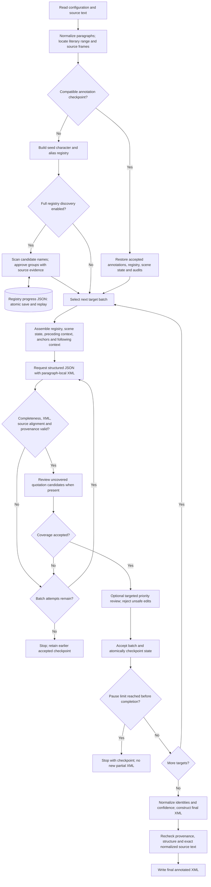

# Austen Annotation Pipeline: v1 to v16_1

This commit preserves the development history of a Python pipeline for annotating Jane Austen's fiction and documents the latest included implementation, `annotate_austen-v16_1.py`. Historical scripts are retained for reproducibility; they should not be assumed to produce identical annotation scopes, schemas, or checkpoint formats.

## How v16_1 performs annotation

This chapter follows the implementation in [annotate_austen-v16_1.py](annotate_austen-v16_1.py). The pipeline is a sequential, checkpointed process: a language model makes contextual literary decisions, while Python validates the response, preserves the source, controls identity mappings, and decides which results can be committed. It is not seven independent classifiers, and it does not train or fine-tune a model during a run. The student workbook is not an input to annotation.

### End-to-end workflow

The diagram separates mandatory validation from optional priority review. Registry discovery has its own progress file because it can run before an annotation checkpoint exists.



A registry-group failure is handled by its own retry policy, not the annotation-batch retry loop shown above. A compatible registry-progress file can be replayed even when no annotation checkpoint exists. An incompatible checkpoint is rejected rather than silently treated as a compatible run.

### 1. Read the source and establish stable paragraph coordinates

The script reads the text, extracts available title/author metadata, identifies the literary range, and builds a list of non-empty, whitespace-normalized paragraphs. Retained material outside the annotation range remains part of the exported paragraph sequence. Source-format handling and book-specific rules distinguish headings, boilerplate, and literary content; *Lady Susan* additionally uses letter/correspondent frames.

The distinction between **source preservation** and **annotation scope** is essential:

- The complete retained paragraph list defines stable zero-based indices.
- The literary start/end indices determine which paragraphs are annotation targets.
- Headings and other recognized non-content material are not automatically interpreted as speech.
- Context paragraphs are references, not extra targets.
- All inline spans are local to one paragraph; the model cannot create a turn spanning several paragraphs.

The script preserves normalized paragraph text, not the original file's byte offsets, line wrapping, or blank-line layout. Local provenance fields such as `S_ref_p` and `A_ref_p` use the original indices in this retained normalized list.

### 2. Establish the character registry before assigning identities

The initial registry combines book-specific normalization dictionaries with model-generated character/alias information. For long books, the initial model-assisted registry uses a sample from the beginning, middle, and end rather than assuming that the opening chapters contain every character. The later full discovery pass addresses additional candidate names across the literary text.

Identity safety is enforced separately from literary inference:

- Explicit names and unambiguous aliases can map to canonical identities.
- Shared or conflicting aliases are tracked as ambiguous rather than arbitrarily assigned.
- Pronouns and relational descriptions must not become global aliases.
- A shared surname alone is not sufficient evidence that two mentions denote the same person.
- Unresolved participants remain `Unknown` rather than being forced into a plausible registry identity.

With `--registry-discovery full`, the script scans the literary text for candidate names, collects source evidence, and sends candidate groups for contextual approval. The default group contains up to 40 candidate names. Regex extraction proposes candidates; it does not establish that a candidate is a character.

Approval records contain `source_name`, `canonical_name`, `paragraph_index`, and `evidence_quote`. In v16_1, `source_name` must match a supplied candidate exactly, including possessives and leading words. The normalized identity belongs in `canonical_name`; another name appearing nearby cannot be substituted as the requested candidate.

Discovery saves a fixed candidate plan and seed registry in `*_registry_progress.json`. Completed groups are saved atomically and replayed locally after compatible restarts. Temporary failures and invalid responses are retried within the configured limit, five total attempts by default. Invalid model responses receive specific corrective feedback; the correction replaces earlier corrective feedback rather than accumulating indefinitely. Transport failures do not introduce a new correction message.

Later annotation responses can also propose new characters with exact source evidence. Those proposals are staged within the current attempt: a failed annotation attempt must not publish registry changes into the accepted run state.

### 3. Resume only when the saved run is compatible

Before reusing accepted annotation work, the script checks checkpoint metadata and fingerprints, including the source, script, prompts, model/backend, and relevant run policy. It also validates saved annotations, scene continuity, and audit information rather than trusting the checkpoint solely because it is readable JSON.

A compatible annotation checkpoint restores completed paragraph results, paragraph confidence, validated non-annotation paragraphs, registry state, scene states, and review records. Processing continues at the next unprocessed target. Registry discovery has separate resumable state because an interruption can occur during that prepass, before annotation starts.

Use a separate output directory for a changed script or annotation policy. `--fresh` starts again instead of migrating old annotations. Progress files assume a single writer; they are not a coordination mechanism for concurrent runs.

### 4. Assemble bounded context for each target batch

The default primary annotation batch contains **20 target paragraphs**. Each request combines the canonical character inventory, the current scene-character state, source-frame information where relevant, and three kinds of reference context:

1. **Recent preceding context:** up to 40 paragraphs, stopping after the whole paragraph that reaches an 8,000-source-character threshold.
2. **Older scene anchors:** up to six selected source cues from the same chapter within a 200-paragraph lookback, with a separate hard 3,000-source-character budget. Oversized anchors are skipped, not truncated, and do not displace recent context.
3. **Following context:** up to 30 paragraphs, stopping after the whole paragraph that reaches a 6,000-source-character threshold.

Recent/following character thresholds can be exceeded by the final included paragraph because paragraphs are not cut in half. These counts exclude prompt instructions and other request overhead.

The scene-character state is a contextual aid, not a definitive listener list. Anchors are heuristically selected source cues, not an exhaustive persistent scene model. Following context can clarify a speaker or a later-explicit participant, but cannot advance the scene state beyond the target paragraph's endpoint.

### 5. Ask for a complete structured response, not a rewritten passage

The primary model call returns JSON with one record for every target paragraph. Each record contains:

- `paragraph_index`: the exact source paragraph index.
- `scene_characters_present`: characters physically present at the paragraph's endpoint.
- `has_speech`: the historical flag meaning **contains inline annotation**, including a letter-only paragraph.
- `paragraph_confidence`: the model's confidence in the paragraph-level decision.
- `annotated_xml`: the source paragraph with inline tags, or an empty string when no annotation is required.

Optional top-level `new_characters` proposals can extend the registry after evidence checks. The response must not omit, duplicate, invent, or return reference-only paragraph indices.

The model receives the seven objectives together, with turn boundaries, speakers, addressees, and listener presence prioritized over named listeners and representation subtype. These are prompt priorities, not separate independently optimized passes.

### 6. Apply the literary annotation policy

**Turn boundaries.** The model marks represented content and separates turns when speakers change or when the actual addressee subset changes. Several simultaneous addressees can share one turn; successive changes of addressee may require splitting. A quotation embedded within an existing turn remains text of that current turn rather than a nested turn.

**Speakers and addressees.** `S` and `A` use canonical identities, with ` + ` separating multiple participants. Context, reporting clauses, explicit names, and conversational continuity support the attribution. Where evidence is insufficient, `Unknown` is preferable to an invented identity. Explicit self-address instead uses `A=""` with `self_address="speech"` or `self_address="thought"`.

**Bystanders.** The model distinguishes addressed participants from other listeners. Physical presence alone is not sufficient to prove that a person hears a particular exchange. Scene continuity, audibility, and explicit listening evidence matter; sleeping, absent, or otherwise excluded people must not be added merely because they belong to the household or wider group. Conversely, an established silent member of a listening group should not disappear simply because that person has no line of dialogue. The field contains explicit names or `no`, never a bare `yes`.

**Representation.** Every turn receives `NO`, `IS`, or `FID`. `NO` denotes direct representation and can include directly represented thought. `IS` concerns communicated speech/writing, not ordinary silent reported thought. Genuine FID remains in scope, but its label does not independently prove that the represented content was spoken aloud.

**Letters and interruptions.** Represented letters/notes are separate `<letter>` spans, even when read aloud, with `reading="silent|aloud|unknown"`. Narrator material interrupting a turn can be wrapped in a leaf `<interruption>`. Neither mechanism permits nested turns.

**Anonymous local roles.** An anonymous participant remains `Unknown`. Optional `S_ref`/`S_ref_p` or `A_ref`/`A_ref_p` can retain a literal source description and its paragraph index. These references do not create a global character or authorize merging anonymous mentions across scenes.

These are intended annotation rules. The deterministic checks below enforce the protocol and source alignment, but cannot prove every semantic decision correct.

### 7. Validate every paragraph before accepting the batch

The script checks the structured response and inline XML before committing results:

- Exactly the expected target paragraph indices must be returned.
- `has_speech` must agree with whether inline XML is supplied.
- Confidence values and scene-character lists must have valid forms.
- Only supported XML elements and attributes are allowed.
- Turns must be direct children of the paragraph; interruptions are leaf children of turns; letters are separate paragraph-level leaves.
- Required participant/representation attributes and self-address constraints must be satisfied.
- Tags must not split words, and represented content cannot consist solely of an interruption.
- Anonymous-role descriptions must occur literally in the cited paragraph within the supplied source context.
- Stripping annotation tags must recover the normalized source paragraph.

The alignment routine can map narrowly permitted whitespace/quotation/dash discrepancies back onto the source, but rejects alphanumeric edits. It is not permission for the model to paraphrase. Final export checks exact normalized source text again.

An invalid mandatory result fails the batch attempt. The next attempt requests the complete batch again with validation feedback. Annotation has ten total attempts with bounded retry delays; validation is not relaxed on later attempts. Exhausting attempts stops processing while earlier accepted batches remain available in the checkpoint.

### 8. Review uncovered quotations as a coverage gate

The script detects quotation candidates not covered by the current annotation. For eligible paragraphs, a separate semantic model call decides whether each uncovered candidate is genuinely missed annotation or can legitimately remain unannotated. This avoids equating every quotation mark with a speech turn.

The quote-review request includes the original paragraph, current annotation, candidate IDs, recent preceding references, following references, and relevant source-frame context. Its local preceding payload is restricted to the last eight entries of the assembled review context; it is not simply another full primary-annotation request.

Every candidate needs a valid decision, confidence, and reason. A candidate is accepted as legitimately uncovered only when `missed_annotation` is false and confidence is at least `0.85`. A missed candidate, low-confidence decision, or invalid review response fails the current batch attempt and triggers regeneration through the mandatory retry loop.

**This review does not directly insert a missing turn.** It gates acceptance of the batch and records its decisions in the quote-review audit. It may add several calls within a batch, depending on the number of eligible paragraphs.

### 9. Run conservative targeted priority review

After mandatory checks and quote coverage succeed, the optional priority stage selects suspicious paragraphs using deterministic risk flags. These flags are not declarations that the first-pass annotation is wrong. They include:

- Unknown direct participants or an unknown indirect speaker.
- Multiple addressees that might represent successive rather than joint address.
- Punctuation/name patterns suggesting an internal vocative change.
- A small scene with additional people but `bystanders="no"`, requiring an audibility check rather than automatic inclusion.

Silent thoughts skip audible-audience/addressee/vocative heuristics; an unknown thinker can still be selected for identity review. By default, up to **four paragraphs**, not four turns, are selected for one grouped review call.

The reviewer cannot freely rewrite the annotation. It can propose eligible direct-turn splits and participant corrections while preserving validated represented content and protected attributes. Unknown-speaker resolution requires a registry identity and a literal evidence quotation. An existing `IS` turn with unknown speaker has a narrower speaker-only correction path; this does not authorize splitting or relabeling indirect turns.

Each proposed edit is validated independently. Unsafe edits are rejected and the first-pass paragraph survives. A priority-review call failure also leaves the validated batch usable. Accepted review decisions cannot inflate paragraph confidence: the lower of the original and reviewed paragraph confidence is retained. Review selection, accepted changes, unchanged results, rejections, and call errors are recorded in an audit.

**Unlike quote review, priority review is an optional refinement stage, not a mandatory batch-acceptance gate.**

### 10. Commit accepted state and continue sequentially

Once a batch is accepted, its paragraph annotations, confidence, validated non-annotation decisions, registry updates, and endpoint scene state become part of the accepted run. The script atomically writes the annotation checkpoint before moving on.

This makes the batch the practical recovery boundary: an interrupted uncommitted batch can be requested again, while previously accepted batches need not be reannotated. Registry-discovery progress uses its own analogous boundary at the candidate-group level.

With `--max-batches N`, the script pauses after the configured number of newly processed batches. It saves checkpoint state without publishing a new partial XML. Resume with the compatible command and without `--fresh`. API usage records describe responses received, not a definitive billing ledger or a guarantee that no remote call can repeat.

### 11. Normalize and verify the final XML

After all targets are processed, export constructs the document from the retained source paragraphs and accepted inline annotations. It normalizes participant names, removes speakers/addressees from bystander lists, assigns sequential document-wide turn numbers, and formats confidence values. Unknown participants trigger the implemented `0.50` turn-confidence cap; paragraph confidence also reflects the minimum confidence of relevant contained annotations.

The exporter retains separate letters and explicit self-address, preserves local anonymous-role references, and revalidates those references against the full paragraph list. It checks the final XML and verifies that each paragraph's text still matches the normalized source. Only after successful completion does the pipeline write the final annotated XML.

The result records schema `16.0`, including when produced by v16_1. The later XML-format chapter documents the exact elements and attributes; the command-line chapter lists all configurable controls.

### What this architecture guarantees, and what it does not

The pipeline is designed to make annotation **recoverable, auditable, structurally constrained, and source-preserving**. It does not guarantee correct literary interpretation, exhaustive listener detection, or calibrated uncertainty. The model still makes the central semantic decisions, and targeted review uses the same configured model rather than an independent human reference.

Offline tests check implementation behavior, including mocked failure/recovery paths. They are not evidence of improved annotation precision or recall. Quantitative literary evaluation requires a separately assessed reference and a defined matching policy; uncertain student annotations should not silently become unquestioned truth.

## Annotation objectives

The pipeline follows this priority order:

1. **Must:** detect turns and their boundaries.
2. **Must:** identify speakers.
3. **Must:** identify addressees, including multiple addressees.
4. **Must:** detect whether other listeners are present.
5. **Should:** identify the bystanders listening to the exchange.
6. **Should:** detect indirect representation.
7. **Could:** distinguish indirect speech (`IS`) from free indirect discourse (`FID`).

The code combines structured model responses with deterministic checks for paragraph completeness, text preservation, XML structure, identity normalization, and checkpoint consistency. Passing those checks does not establish literary accuracy.

## Changelog

The entries below describe implementation changes, not measured improvements in annotation accuracy. File names are preserved exactly, including the switch from underscores to hyphens after v4.

### v1: Initial annotation pipeline

Source: [annotate_austen_v1.py](annotate_austen_v1.py)

- Introduces plain-text parsing, batched annotation, preceding context, and scene-character tracking.
- Generates inline XML for turns and narrator interruptions, with speaker, addressee, and bystander fields.
- Builds a model-assisted character registry and normalizes aliases to canonical identities.
- Includes built-in normalization dictionaries for *Pride and Prejudice* and *Sense and Sensibility*.
- Supports the Gemini SDK, with an API-key REST fallback, and JSON checkpointing.
- Uses the earlier indirect-speech convention rather than the later mandatory `NO`/`IS`/`FID` protocol.

### v2: Corpus-wide normalization

Source: [annotate_austen_v2.py](annotate_austen_v2.py)

- Expands built-in character normalization to seven works: *Pride and Prejudice*, *Sense and Sensibility*, *Emma*, *Lady Susan*, *Mansfield Park*, *Northanger Abbey*, and *Persuasion*.
- Extends aliases and canonical identities while retaining the original annotation architecture.

### v3: Vertex AI backend and English-language implementation

Source: [annotate_austen_v3.py](annotate_austen_v3.py)

- Adds Google Cloud project/location configuration and Vertex AI support alongside API-key access.
- Converts documentation, prompts, and user-facing diagnostics to English.
- Retains corpus-wide normalization and the existing batch/checkpoint workflow.

### v4: Representation categories and output organization

Source: [annotate_austen_v4.py](annotate_austen_v4.py)

- Introduces explicit `IS` and `FID` representation labels.
- Extends instructions for letters, notes, and self-directed speech.
- Adds boilerplate handling and representation-label normalization.
- Writes XML and checkpoints to `output/` by default.
- Adds fresh-run and legacy IS/FID upgrade controls. The upgrade option is no longer a migration mechanism in v16_1.

### v5: Confidence and checkpoint integrity

Source: [annotate_austen-v5.py](annotate_austen-v5.py)

- Adds confidence values to paragraphs, turns, and interruptions.
- Introduces a confidence strategy involving model self-assessment and available token log probabilities, plus configurable `needs_review` flagging.
- Adds explicit tracking of validated non-speech paragraphs, one-to-one paragraph completeness checks, persisted batch scene states, atomic JSON writes, and input hashing.
- Adds serialization and export checks designed to avoid modifying paragraph text through XML formatting.

### v6: Stricter validation and unblended confidence

Source: [annotate_austen-v6.py](annotate_austen-v6.py)

- Replaces blended confidence and automatic review flags with unblended confidence for downstream analysis.
- Rejects alphanumeric source edits, mid-word annotation boundaries, and missing participant attributes.
- Strengthens quote coverage, `has_speech` consistency, checkpoint metadata validation, scene-state propagation, and final export verification.
- Introduces explicit schema version `6.0`.

### v7: Reproducibility and semantic quote review

Source: [annotate_austen-v7.py](annotate_austen-v7.py)

- Adds script/prompt fingerprints and stricter resume compatibility checks.
- Adds targeted semantic review of uncovered quotations rather than treating every quotation mark as dialogue.
- Records quote-review decisions in checkpoints.
- Adds offline regression tests through `--self-test`.
- Clarifies that confidence is self-reported and uncalibrated, and text preservation refers to normalized paragraphs.

### v8: Safer identity resolution

Source: [annotate_austen-v8.py](annotate_austen-v8.py)

- Adds collision-safe alias handling and explicit tracking of ambiguous aliases.
- Prevents relational descriptions and pronouns from becoming unsafe global identity mappings.
- Preserves `Unknown` when local evidence does not justify a specific identity.
- Strengthens audibility guidance for bystanders.
- Clarifies that separate occurrences of `Unknown` must not be merged into one network node.

### v9: Expanded context, thinking controls, and usage logging

Source: [annotate_austen-v9.py](annotate_austen-v9.py)

- Uses 20 target paragraphs and 40 recent preceding paragraphs by default.
- Adds older same-chapter source cues, initially up to 12 within a 200-paragraph lookback.
- Adds stage-specific thinking levels/budgets and model-family-dependent configuration.
- Adds append-only `*_usage.jsonl` logging, including returned thinking-token metadata.
- Includes context and thinking policy in resume compatibility checks.

### v10: Flat turns and more retries

Source: [annotate_austen-v10.py](annotate_austen-v10.py)

- Forbids nested turns: every turn must be a direct child of a paragraph.
- Keeps quoted material embedded within a current turn as ordinary text attributed to that turn's speaker.
- Raises annotation batch attempts from four to ten total attempts.
- Caps retry backoff at 60 seconds without weakening validation on later attempts.

### v11: Bidirectional context and mandatory representation labels

Source: [annotate_austen-v11.py](annotate_austen-v11.py)

- Requires `indirectspeech="NO|IS|FID"` on every turn.
- Separates representation form from communication medium: `NO` does not itself prove speech aloud.
- Adds following reference-only context: up to 30 paragraphs and a 6,000-source-character threshold.
- Limits preceding context to 40 paragraphs and an 8,000-source-character threshold.
- Preserves whole paragraphs, allowing the final included paragraph to exceed those thresholds.
- Disables older anchors by default in this version.
- Prevents following context from advancing target-end scene state.

### v12: Priority-aware review and controlled pauses

Source: [annotate_austen-v12.py](annotate_austen-v12.py)

- Makes the seven annotation priorities explicit.
- Restores splitting when the actual addressee subset changes.
- Adds targeted priority review of up to four suspicious paragraphs per batch by default.
- Allows conservative direct-turn splitting and participant corrections while protecting validated coverage and representation categories.
- Rejects unsafe review edits individually, retaining the validated first pass.
- Adds `--max-batches` for checkpoint-only pauses without publishing partial XML.

### v13: Independent anchors and evidence-backed speaker resolution

Source: [annotate_austen-v13.py](annotate_austen-v13.py)

- Enables six older same-chapter anchors by default, with a separate hard 3,000-source-character budget and 200-paragraph lookback.
- Prevents anchors from displacing recent context; skips oversized anchors instead of truncating them.
- Restricts `IS` to communicated speech/writing, excluding ordinary silent reported thought while retaining genuine FID and directly represented thought.
- Strengthens collective-group guidance so established silent members are not dropped merely because they do not speak.
- Allows priority review to resolve an unknown speaker to a registry identity with a literal source evidence quotation; known speakers remain protected.
- Strengthens review-audit validation.

### v14: Corpus frames and epistolary context

Source: [annotate_austen-v14.py](annotate_austen-v14.py)

- Adds explicit corpus policy, safer handling of book-specific ambiguous aliases, and source-frame indexing.
- Adds letter/correspondent frames for *Lady Susan* and supplies relevant frame context to annotation calls.
- Extends constrained speaker-review handling to indirect representation.
- Writes a frame report for inspection.
- Retains schema `13.0` but changes the prompt fingerprint. The filename version is not the XML schema version.

### v14_1: Registry and letter-parser fixes

Source: [annotate_austen-v14_1.py](annotate_austen-v14_1.py)

- Preserves book-specific ambiguous-alias exclusions when the default registry has been extended, rather than requiring exact dictionary equality.
- Accepts whole, name-shaped correspondent headers without terminal punctuation.
- Avoids confusing consecutive table-of-contents entries with the first actual letter in *Lady Susan*.
- Improves header-only boilerplate detection.
- Retains schema `13.0` and updates the prompt fingerprint.

### v15: Separate letters, explicit self-address, and registry discovery

Source: [annotate_austen-v15.py](annotate_austen-v15.py)

- Introduces schema `15.0` and a separate leaf `<letter>` element, including when a letter is read aloud.
- Adds `reading="silent|aloud|unknown"` to letter spans.
- Represents self-address with `A=""` and `self_address="speech|thought"`, rather than a self-loop in the addressee field.
- Adds a whole-literary-text candidate-name scan with contextual model approval.
- Allows evidence-backed registry additions from successful annotation batches.
- Preserves all non-empty normalized source paragraphs, keeping the annotation range separate from exported source content.
- Ensures failed attempts do not commit partial paragraph results or registry changes.
- Treats the historical `has_speech` flag as “contains annotation,” including letter-only paragraphs.

### v16: Resumable registry discovery and local anonymous-role provenance

Source: [annotate_austen-v16.py](annotate_austen-v16.py)

- Introduces schema `16.0`.
- Adds independent `*_registry_progress.json` state for the discovery prepass, including a fixed candidate plan, fingerprints, atomic persistence, and local replay of completed groups.
- Adds bounded registry retries with exponential backoff and jitter, five total attempts per discovery group by default.
- Preserves anonymous speakers/addressees as `Unknown` while optionally recording literal local descriptions through `S_ref`/`S_ref_p` and `A_ref`/`A_ref_p`.
- Checks local-description provenance against source paragraphs during processing, resume, and export.
- Prevents local anonymous descriptions from becoming global aliases or being merged across scenes.
- Excludes silent thoughts from audible-audience, addressee, and vocative review heuristics while retaining unknown-thinker identity review.

### v16_1: Corrective registry retries

Source: [annotate_austen-v16_1.py](annotate_austen-v16_1.py)

- Requires `source_name` to match a supplied candidate exactly, including possessives and leading words; identity normalization belongs in `canonical_name`.
- Validates proposal structure before accessing record fields.
- Returns more specific validation errors for malformed or unrequested candidate proposals.
- Adds corrective feedback to retries after invalid model responses.
- Replaces corrective feedback on each validation failure rather than accumulating an ever-growing prompt.
- Does not introduce new corrective instructions for transport failures.
- Leaves the command-line interface, schema `16.0`, and prompt-version constant unchanged from v16. Script fingerprints still distinguish the two files for resume checks.

## v16_1 command-line reference

### Basic usage

```bash
python annotate_austen-v16_1.py path/to/novel.txt
python annotate_austen-v16_1.py --help
python annotate_austen-v16_1.py --self-test
```

`input_txt` is required for annotation. `--self-test` is handled before normal argument parsing and does not require an input file or credentials. `-h`/`--help` displays the argument reference and exits.

### Input, output, and execution

| Argument | Default | Description |
| --- | --- | --- |
| `input_txt` | Required | Path to the source `.txt` file. |
| `--output-dir`, `-d` | `output` | Directory for checkpoints, usage logs, registry progress, frame reports, and the default XML output. |
| `--output`, `-o` | Derived | Explicit XML path; otherwise `<output-dir>/<input_stem>_annotated.xml`. Does not relocate all sidecars. |
| `--model`, `-m` | `gemini-4-argon` | Model identifier passed to the backend. This is the script default, not a guarantee of model availability. |
| `--fresh` | Disabled | Ignore existing annotation checkpoints and start again; back up existing checkpoint/progress files as implemented. |
| `--max-batches` | `0` | Pause after this many newly processed annotation batches. `0` runs to completion. A pause saves checkpoints but does not publish partial XML. |
| `--self-test` | Disabled | Run offline regression tests without credentials. |
| `--upgrade-is-fid` | Disabled | Deprecated compatibility flag. Rejected unless combined with `--fresh`; does not migrate legacy checkpoints. |
| `-h`, `--help` | N/A | Show usage and exit. |

### Batch and context selection

| Option | Default | Description |
| --- | --- | --- |
| `--batch-size` | `20` | Number of target paragraphs per annotation batch. Must be positive. |
| `--context-size` | `40` | Maximum recent preceding paragraphs. Must be non-negative. |
| `--context-max-chars` | `8000` | Preceding source-character threshold. Whole paragraphs are retained; the last included paragraph may exceed it. |
| `--following-context-size` | `30` | Maximum following reference-only paragraphs. |
| `--following-context-max-chars` | `6000` | Following source-character threshold, also using whole paragraphs. |
| `--scene-anchor-limit` | `6` | Maximum older same-chapter source cues. `0` disables anchors. |
| `--scene-anchor-max-chars` | `3000` | Separate hard character budget for whole older anchors. Oversized cues are skipped. |
| `--scene-anchor-lookback` | `200` | Maximum preceding paragraphs searched for anchors, bounded by the current chapter. |

Character counts refer to source text, not the complete API prompt. Labels, separators, instructions, and target text are not included in these context thresholds. Following context is reference-only and must not be returned as target output or used as the target's final scene state.

### Thinking configuration

| Option | Default | Description |
| --- | --- | --- |
| `--thinking-mode` | `auto` | `auto`, `level`, `budget`, or `off`. Automatic mode selects levels for recognized Gemini 3/4 names and budgets for 2.5. Unknown model families require an explicit mode. |
| `--annotation-thinking` | `HIGH` | Thinking level for primary annotation. |
| `--review-thinking` | `LOW` | Thinking level for uncovered-quote review, not priority review. |
| `--registry-thinking` | `MEDIUM` | Thinking level for registry work. |
| `--annotation-budget` | `8192` | Annotation thinking-token budget when budget mode applies. |
| `--review-budget` | `1024` | Quote-review thinking-token budget when budget mode applies. |
| `--registry-budget` | `2048` | Registry thinking-token budget when budget mode applies. |
| `--priority-review-thinking` | `HIGH` | Thinking level for priority review. |
| `--priority-review-budget` | `8192` | Priority-review thinking-token budget when budget mode applies. |

All four thinking-level options accept `DEFAULT`, `LOW`, `MEDIUM`, or `HIGH`. `DEFAULT` omits an explicit setting for that stage. `--thinking-mode off` omits thinking configuration; it does **not** guarantee that provider-default thinking is disabled. Budget controls are not interchangeable with modern-model thinking levels; the script rejects incompatible combinations.

### Priority review

| Option | Default | Description |
| --- | --- | --- |
| `--priority-review` | `targeted` | `targeted` enables conservative review of suspicious annotations; `off` disables this stage. |
| `--priority-review-limit` | `4` | Maximum selected paragraphs per batch, not turns. Review uses at most one additional call for the selected group in a successful batch attempt. |

Review preserves validated text and coverage. It can split eligible direct turns and revise participants within the implemented safeguards. Evidence-backed unknown-speaker resolution is permitted; arbitrary changes to known speakers, represented content, letter spans, self-address classification, and IS/FID categories are restricted. Silent thoughts are excluded from audible-audience heuristics.

### Registry discovery and retries

| Option | Default | Description |
| --- | --- | --- |
| `--registry-discovery` | `full` | `full` scans the literary text for candidate names and requests contextual approval. `off` disables this additional discovery prepass, not all registry construction. |
| `--registry-candidate-batch-size` | `40` | Candidate names per discovery validation call. Must be positive. |
| `--registry-max-attempts` | `5` | Total attempts per discovery group, including the first request. |
| `--registry-retry-base` | `2.0` | Base retry delay in seconds. |
| `--registry-retry-cap` | `60.0` | Maximum registry retry sleep in seconds. |

These retry options control registry discovery, not annotation batch retries. Annotation batches retain ten total attempts with retry backoff capped at 60 seconds. Discovery progress is saved independently of the annotation checkpoint; resume without `--fresh` to reuse completed discovery groups. A crash between receiving and saving a response can still cause one remote call to repeat. Progress files assume a single writer.

### Backend configuration through environment variables

These are environment variables, not command-line flags:

- `GEMINI_API_KEY`: API key for API-key access.
- `GOOGLE_API_KEY`: fallback API-key variable.
- `GOOGLE_CLOUD_PROJECT`: project identifier for Vertex AI access.
- `GOOGLE_CLOUD_LOCATION`: location, defaulting to `eu` in this script.

Use an appropriately configured backend and a model/location available to that account. Backend defaults in the source are not live service-availability claims. The optional `google-genai` SDK must support the requested configuration; API-key REST fallback is available where implemented.

### Example runs

Start an isolated run with explicit output organization:

```bash
python annotate_austen-v16_1.py pride_and_prejudice.txt \
  --output-dir output/pride_and_prejudice_v16_1 \
  --batch-size 20 \
  --context-size 40 \
  --following-context-size 30
```

Pause after two newly processed annotation batches:

```bash
python annotate_austen-v16_1.py pride_and_prejudice.txt \
  --output-dir output/pride_and_prejudice_v16_1 \
  --max-batches 2
```

Resume with the same annotation policy, without `--fresh` or the pause limit:

```bash
python annotate_austen-v16_1.py pride_and_prejudice.txt \
  --output-dir output/pride_and_prejudice_v16_1
```

Use separate output directories for different script versions or annotation policies. Resume checks include source, script, prompt, model, backend, and relevant run-policy fingerprints. Do not modify a script while its run is in progress.

## Generated XML format: schema 16.0

This section describes the XML protocol generated by v16_1. It is not an assertion that an XSD file is included. The script validates structure and attributes programmatically.

### Document structure

```text
book
└── p (repeated, mixed content)
    ├── ordinary source text
    ├── turn (zero or more, direct children of p)
    │   ├── represented content
    │   └── interruption (zero or more, leaf children of turn)
    └── letter (zero or more, leaf children of p)
```

Paragraphs preserve the normalized source order, including retained front/back matter outside the annotation range. A paragraph may contain plain narrative, several turns, letter spans, and intervening source text. No turn spans multiple `<p>` elements.

### Root element: `<book>`

| Attribute | Meaning |
| --- | --- |
| `title` | Parsed book title. |
| `author` | Parsed author. |
| `model` | Model identifier used for the run. |
| `annotation_schema` | `16.0`, including for script v16_1. |
| `letter_policy` | `separate`. |
| `self_address_policy` | `explicit_empty_addressee`. |
| `anonymous_reference_policy` | `local_source_description`. |

### Paragraph element: `<p>`

- Contains mixed source text and inline annotation.
- Carries `confidence`, serialized as a decimal between `0.00` and `1.00`.
- Does not export the internal paragraph index as a required XML attribute. To resolve local provenance references, enumerate the root's paragraphs from zero.
- Internal checkpoint fields such as `has_speech`, scene-character lists, and review audit records are not additional XML child elements.

### Turn element: `<turn>`

| Attribute | Requirement and meaning |
| --- | --- |
| `n` | Added during final export: sequential document-wide turn number. Not supplied as an arbitrary model attribute. |
| `S` | Required non-empty speaker/source identity. Multiple identities use ` + `. `Unknown` is permitted. |
| `A` | Required addressee identity or identities. Empty only with explicit `self_address`. `Unknown` is permitted. |
| `bystanders` | Required: `no` or explicit canonical names separated by ` + `. Bare `yes`, `unknown`, and `?` are invalid. |
| `indirectspeech` | Required: exactly `NO`, `IS`, or `FID`. |
| `confidence` | Confidence value between `0.00` and `1.00`. |
| `self_address` | Optional: `speech` or `thought`; requires `A=""`. |
| `S_ref` | Optional literal local source description for an anonymous speaker whose `S` is `Unknown`. |
| `S_ref_p` | Required with `S_ref`: original zero-based normalized paragraph index containing the description. |
| `A_ref` | Optional literal local source description for an anonymous addressee whose `A` is `Unknown`. |
| `A_ref_p` | Required with `A_ref`: original zero-based normalized paragraph index containing the description. |

Participant fields use canonical identity strings, not XML ID/IDREF links. Export removes speakers and addressees from the bystander list. Canonical names are stable corpus identifiers and need not reproduce the character's title or marital status at the precise point in the story.

#### Representation labels

- **`NO`**: direct representation, including directly represented speech or thought. It is not an independent medium label.
- **`IS`**: communicated content represented indirectly, including speech or writing. Ordinary silent reported thought is outside this category's intended scope.
- **`FID`**: free indirect discourse. The label alone does not establish whether the represented perspective is spoken or silent.

#### Self-address

- `self_address="speech"` requires `A=""` and `indirectspeech="NO"`.
- `self_address="thought"` requires `A=""` and `bystanders="no"`.
- Directly represented thought uses `NO`; genuine silent FID can use `FID` with explicit thought self-address.
- An empty addressee means explicit self-address, not merely an unresolved external addressee. Use `Unknown` for the latter.

#### Anonymous-role provenance

The reference attributes preserve local descriptions without inventing global identities. Each description/index pair is allowed only on its corresponding `Unknown` field. Indices refer to the complete normalized paragraph list, not source-file line numbers, batch-relative indices, or the literary slice alone.

Descriptions must occur literally in the cited source paragraph and are checked again on resume/export. Literal presence is not proof that the semantic attribution is correct. Do not merge separate anonymous roles or `Unknown` mentions across scenes.

### Interruption element: `<interruption>`

- A leaf child of `<turn>`.
- Marks narrator material interrupting represented content.
- Carries `confidence`.
- Cannot contain another turn, letter, or interruption.
- A turn consisting only of an interruption is invalid.

### Letter element: `<letter>`

- A leaf directly inside `<p>`, separate from turns.
- Requires exactly `reading` and `confidence`.
- `reading` accepts `silent`, `aloud`, or `unknown`.
- Contains the represented letter/note text, including when it is read aloud.
- Has no turn number or speaker/addressee/bystander fields in this protocol.
- Cannot contain nested turns or interruptions.
- A multi-paragraph letter is represented by separate paragraph-local letter spans, not one wrapper crossing paragraph boundaries.

### Illustrative XML

The following invented text illustrates the structure only; it is not an excerpt from a novel or an actual run result. Provenance index `0` refers to the first paragraph in this miniature document.

```xml
<?xml version="1.0" encoding="utf-8"?>
<book title="Illustrative Example"
      author="Example Author"
      model="configured-model"
      annotation_schema="16.0"
      letter_policy="separate"
      self_address_policy="explicit_empty_addressee"
      anonymous_reference_policy="local_source_description">
  <p confidence="0.50">The messenger arrived. <turn n="1" S="Unknown" A="Miss Nora Vale" bystanders="Mr. Owen Vale" indirectspeech="NO" confidence="0.50" S_ref="The messenger" S_ref_p="0">"The carriage is ready," <interruption confidence="0.98">said the messenger.</interruption></turn></p>
  <p confidence="0.50">Nora replied <turn n="2" S="Miss Nora Vale" A="Unknown" bystanders="Mr. Owen Vale" indirectspeech="IS" confidence="0.50">that she would leave shortly.</turn></p>
  <p confidence="0.90"><turn n="3" S="Miss Nora Vale" A="" bystanders="no" indirectspeech="NO" confidence="0.90" self_address="thought">"I must remember the key,"</turn> she thought.</p>
  <p confidence="0.97"><letter reading="silent" confidence="0.97">Please meet us at the gate.</letter></p>
</book>
```

### Structural and interpretive safeguards

- Turns are flat siblings, never nested.
- Letters are separate leaf siblings of turns.
- Only supported annotation elements and attributes are accepted.
- Annotation must preserve the normalized paragraph text, including text outside turns.
- Confidence is not a calibrated probability of correctness. Export caps turn confidence at `0.50` when a speaker or addressee remains `Unknown`; this is a heuristic, not empirical calibration.
- Whitespace normalization occurs before annotation. Text-preservation guarantees do not imply byte-for-byte preservation of the original `.txt` file.
- Structural validity and source alignment do not prove correct speakers, listeners, or literary categories.

## Run results and output artifacts

See the repository's [output directory](output/) for the concrete results of the different runs. Use the actual files and their metadata to identify the producing model and schema; a result filename suffix is not necessarily a script version.

Depending on the version and run, output artifacts include:

- `*_annotated.xml`: final annotated text.
- `*_checkpoint.json`: accepted paragraph annotations, confidence, registry/scene state, fingerprints, and audit information as implemented by that version.
- `*_usage.jsonl`: API usage metadata for received responses; not an authoritative billing ledger.
- `*_registry_progress.json`: resumable registry-discovery state in v16/v16_1.
- `*.v15_frames.json`: source-frame report retained under its historical filename in v16_1.
- Backup files created when starting fresh.

The latest script writes final XML only after completing annotation and export checks. A checkpoint-only pause does not create a new partial XML result; an older XML file already present in that directory should not be mistaken for the paused run's current output.

Historical results remain useful for comparison, but differences can reflect changes in model, prompts, annotation scope, context, registry policy, or schema. Do not interpret version progression alone as evidence of higher accuracy.

## Licenses

This project uses a dual-licensing structure:
- **Source code (`*.py`):** Released under the [GNU General Public License v3.0 (GPL-3.0)](LICENSE).
- **Annotated corpus (`corpus/*.xml`):** Released under [Creative Commons Attribution-ShareAlike 4.0 International (CC BY-SA 4.0)](LICENSE-DATA).

---

## How to Cite

If you use the corpus or the annotation pipeline in academic research, please cite:
> [Bolle, Pieter], & [De Smet Hendrik]. (2026). *Computational Literary Annotation of Jane Austen's Novels* (Version 1.0) [Dataset & Software]. [KULeuven / https://github.com/pieterbolle/JaneAusten/].

---

## Acknowledgements & Source Texts

The base plain-text files used for this annotation pipeline were sourced from [Project Gutenberg](https://www.gutenberg.org/), as Jane Austen's novels are in the public domain. We gratefully acknowledge Project Gutenberg and its volunteers for making these digital editions freely available.
